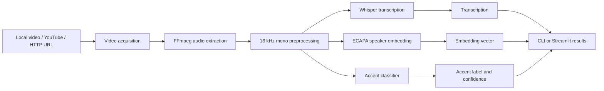

# Video Accent Classification Pipeline

An end-to-end speech-analysis pipeline for downloading or loading video, extracting audio, transcribing speech, generating speaker embeddings, and predicting an accent through a CLI or Streamlit interface.


## Overview

The project accepts a local video, YouTube URL, or direct HTTP video URL. It extracts mono 16 kHz audio with FFmpeg, transcribes speech with OpenAI Whisper, optionally computes an ECAPA-TDNN speaker embedding, and classifies the accent with a pretrained SpeechBrain model.

The modular structure separates downloading, audio processing, transcription, speaker representation, and accent classification so individual stages can be tested or replaced independently.

## Features

- Local video-file input through the CLI
- YouTube downloads with `yt-dlp`
- Direct HTTP video downloads
- FFmpeg audio extraction
- Mono 16 kHz WAV preprocessing
- Whisper speech transcription
- SpeechBrain ECAPA-TDNN speaker embeddings
- Pretrained SpeechBrain accent classification
- Predicted label and confidence output
- Command-line and Streamlit interfaces
- Included research notebook and example video

## Architecture



The speaker embedding is returned by the CLI pipeline for analysis but is not currently used as an additional input to the pretrained accent classifier.

## Project Structure

```text
.
├── main.py                    # Complete command-line pipeline
├── app.py                     # Streamlit interface
├── downloader/
│   ├── youtube.py             # YouTube acquisition
│   └── http.py                # Direct HTTP acquisition
├── audio/
│   ├── extractor.py           # FFmpeg audio extraction
│   └── preprocess.py          # Mono/16 kHz conversion
├── transcription/
│   └── transcriber.py         # Whisper transcription
├── speaker/
│   └── embedder.py            # Speaker embedding extraction
├── accent/
│   └── classifier.py          # Accent classification
├── utils/                     # File and URL helpers
├── research.ipynb             # Development notebook
├── My_Loom_Sample.mp4         # Example input
├── requirements.txt
└── README.md
```

## Setup

### 1. Install system prerequisites

- Python 3.10 or newer
- [FFmpeg](https://ffmpeg.org/download.html) available on the system `PATH`
- Git, because Whisper is installed from its GitHub repository

Verify FFmpeg:

```bash
ffmpeg -version
```

### 2. Clone and create an environment

```bash
git clone https://github.com/SharathKumarReddyAlijarla/Video_accent_Classification.git
cd Video_accent_Classification
python -m venv .venv
```

Windows PowerShell:

```powershell
.\.venv\Scripts\Activate.ps1
```

macOS or Linux:

```bash
source .venv/bin/activate
```

### 3. Install Python dependencies

Install a mutually compatible PyTorch and TorchAudio build for your platform first, following the [PyTorch installation selector](https://pytorch.org/get-started/locally/). Then install the project dependencies:

```bash
python -m pip install --upgrade pip
python -m pip install -r requirements.txt
python -m pip install torchaudio
```

Whisper and SpeechBrain models are downloaded on first use and cached locally.

## Usage

### Command Line

Process a local video:

```bash
python main.py "My_Loom_Sample.mp4"
```

Process a YouTube or direct video URL:

```bash
python main.py "https://www.youtube.com/watch?v=VIDEO_ID"
```

The CLI prints transcription, speaker-embedding shape, predicted accent, and confidence.

### Streamlit Interface

```bash
streamlit run app.py
```

Open the URL shown by Streamlit, enter a YouTube or direct video URL, and select **Process Video**. The current UI accepts URLs; local-file input is available through the CLI.

## Results

The original project documentation recorded the following example outputs:

| Input | Reported accent | Reported confidence |
| --- | --- | ---: |
| Public English-conversation video | England | 78.87% |
| Included Loom sample | Indian | 55.00% |

These examples demonstrate the pipeline and are not a formal accuracy benchmark. Reliable evaluation requires a labeled, speaker-independent dataset with balanced accent classes and clearly defined metrics.

## Technology Stack

| Stage | Technology |
| --- | --- |
| Video acquisition | yt-dlp, Requests |
| Audio extraction | FFmpeg |
| Audio processing | TorchAudio, pydub |
| Transcription | OpenAI Whisper |
| Speaker embeddings | SpeechBrain ECAPA-TDNN |
| Accent classification | SpeechBrain pretrained classifier |
| Deep-learning runtime | PyTorch |
| Web interface | Streamlit |

## Limitations

- Accent labels and supported classes are defined by the third-party pretrained classifier.
- Accent prediction is probabilistic and should not be treated as a statement about identity, nationality, or ethnicity.
- The included examples do not constitute a statistically valid benchmark.
- Model downloads require internet access on first use and can consume significant disk space.
- Whisper defaults to the `base` model on CPU, which can be slow for long recordings.
- Models are initialized inside processing functions, increasing repeated-run latency.
- The speaker embedding is generated but does not affect the final accent prediction.
- The Streamlit interface currently accepts URLs only and processes one video at a time.
- HTTP download validation, size limits, timeouts, automated tests, and production security controls are not yet implemented.
- Users are responsible for respecting privacy, copyright, platform terms, and consent requirements for processed media.

## Acknowledgements

- [OpenAI Whisper](https://github.com/openai/whisper)
- [SpeechBrain](https://speechbrain.readthedocs.io/)
- [yt-dlp](https://github.com/yt-dlp/yt-dlp)
- [FFmpeg](https://ffmpeg.org/)
- [Streamlit](https://streamlit.io/)
